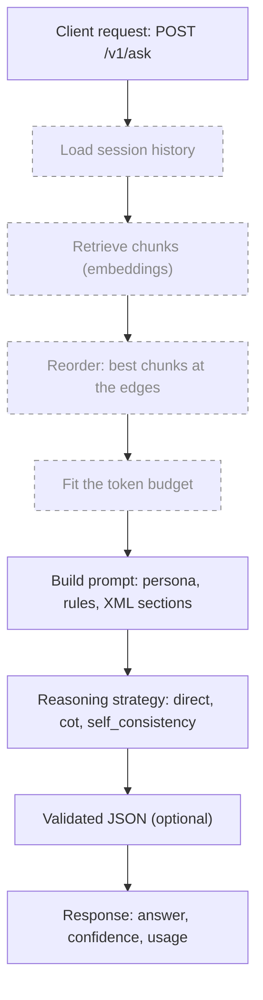

# LLM Gateway

> One FastAPI endpoint where every lesson I study becomes working code.

This project is my hands-on companion to the [AI Engineering from Scratch](https://github.com/rohitg00/ai-engineering-from-scratch). Instead of reading each lesson and moving on, I apply it here: each stage takes the theory from one lesson and turns it into a piece of a single backend service, `POST /v1/ask`.

The service sends a question to an LLM through an OpenAI-compatible API (developed against OpenRouter free models) and wraps that call with the techniques the course teaches: safe key handling, prompt patterns, reasoning strategies, validated JSON, retrieval, and context management.

### Core stages

- [x] **Stage 0 · Setup and tooling**: [Phase 0 · Dev Environment](https://github.com/rohitg00/ai-engineering-from-scratch/blob/main/phases/00-setup-and-tooling/01-dev-environment), [Python Environments](https://github.com/rohitg00/ai-engineering-from-scratch/blob/main/phases/00-setup-and-tooling/06-python-environments)
  - Applied: `uv` manages the virtual environment and dependencies through `pyproject.toml`.
  - Done when: `uv run uvicorn app.main:app --reload` starts without errors.

- [x] **Stage 1 · APIs and keys**: [Phase 0 · APIs & Keys](https://github.com/rohitg00/ai-engineering-from-scratch/blob/main/phases/00-setup-and-tooling/04-apis-and-keys)
  - Applied: API key in `.env` (never in code), raw HTTP calls with `httpx`, a 401 raised immediately, 429 and 5xx retried with backoff.
  - Files: `app/config.py`, `app/llm_client.py`
  - Done when: a script calls `chat()` and prints a reply, and a wrong key produces a clear 401 error.

- [x] **Stage 2 · Minimal endpoint**
  - Applied: FastAPI route, Pydantic request and response models, upstream errors mapped to 429 and 502.
  - Files: `app/main.py`
  - Done when: `/docs` accepts a question and returns an answer; an empty question returns a 422.

- [x] **Stage 3 · Prompt engineering**: [Phase 11 · Lesson 01](https://github.com/rohitg00/ai-engineering-from-scratch/blob/main/phases/11-llm-engineering/01-prompt-engineering)
  - Applied: persona, rules, prompt-injection guardrail, XML-tagged sections, format instruction placed last.
  - Files: `app/prompts.py`
  - Done when: `python app/prompts.py` prints clean prompts with no empty sections.

- [x] **Stage 4 · Few-shot, chain-of-thought, self-consistency**: [Phase 11 · Lesson 02](https://github.com/rohitg00/ai-engineering-from-scratch/blob/main/phases/11-llm-engineering/02-few-shot-cot)
  - Applied: `direct`, `cot` (few-shot plus "think step by step"), and `self_consistency` (sample N paths, majority vote). Tree-of-thought was built and tested, then removed for now (see [lessons learned](#what-i-learned-along-the-way)).
  - Files: `app/reasoning.py`
  - Done when: every strategy answers the train-and-bus question correctly and `self_consistency` returns a `confidence`.

- [x] **Stage 5 · Structured outputs** 🚧 _in progress_: [Phase 11 · Lesson 03](https://github.com/rohitg00/ai-engineering-from-scratch/blob/main/phases/11-llm-engineering/03-structured-outputs)
  - Applied: Pydantic schema, `json.loads` plus schema validation, retry loop that feeds the error back to the model, prompt chaining (reason first, format second).
  - Files: `app/structured.py`
  - Done when: `test_structured.py` shows 3 PASS and 6 expected FAIL cases, and `structured: true` returns `structured_attempts`.

- [x] **Stage 6 · Embeddings and retrieval**: [Phase 11 · Lesson 04](https://github.com/rohitg00/ai-engineering-from-scratch/blob/main/phases/11-llm-engineering/04-embeddings)
  - Applied: chunking with overlap, embeddings through the API, normalized vectors, cosine similarity search.
  - Files: `app/embeddings.py`, `data/knowledge/*.txt`
  - Done when: searching "rate limit" returns the matching chunk first, and a nonsense query scores below `MIN_SCORE`.

- [ ] **Stage 7 · Context engineering**: [Phase 11 · Lesson 05](https://github.com/rohitg00/ai-engineering-from-scratch/blob/main/phases/11-llm-engineering/05-context-engineering)
  - Applied: token budget per prompt component, lost-in-the-middle reordering, conversation history compression, per-session memory.
  - Files: `app/context.py`
  - Done when: a unit test shows the best chunk at the start and the second best at the end, and long histories compress.

- [x] **Stage 8 · Wire it together (RAG)**: [Phase 11 · Lesson 06](https://github.com/rohitg00/ai-engineering-from-scratch/blob/main/phases/11-llm-engineering/06-rag)
  - Applied: retrieve, reorder, fit the budget, build the prompt, run the strategy, optionally validate JSON, save the turn.
  - Files: `app/main.py`
  - Done when: a response includes `sources` and `context_budget`, and a follow-up question uses session history.

### Extensions (planned)

- [ ] **Model profiles**: one registry entry per model (token budget, extra payload fields, response parser, text cleaners) so switching models never touches the strategy code.
- [ ] **Tree-of-thought, again**: [Phase 11 · Lesson 02](https://github.com/rohitg00/ai-engineering-from-scratch/blob/main/phases/11-llm-engineering/02-few-shot-cot), revisited with a model that does not already reason internally.
- [ ] **Function calling**: [Phase 11 · Lesson 09](https://github.com/rohitg00/ai-engineering-from-scratch/blob/main/phases/11-llm-engineering/09-function-calling)
- [ ] **Evaluation harness**: [Phase 11 · Lesson 10](https://github.com/rohitg00/ai-engineering-from-scratch/blob/main/phases/11-llm-engineering/10-evaluation). A fixed question set that compares strategies on accuracy, latency, and cost.
- [ ] **Caching, rate limiting, and cost**: [Phase 11 · Lesson 11](https://github.com/rohitg00/ai-engineering-from-scratch/blob/main/phases/11-llm-engineering/11-caching-cost)
- [ ] **Guardrails**: [Phase 11 · Lesson 12](https://github.com/rohitg00/ai-engineering-from-scratch/blob/main/phases/11-llm-engineering/12-guardrails). A prompt-injection test suite against the system prompt.
- [ ] **Advanced RAG (reranking)**: [Phase 11 · Lesson 07](https://github.com/rohitg00/ai-engineering-from-scratch/blob/main/phases/11-llm-engineering/07-advanced-rag)
- [ ] **Production hardening**: [Phase 11 · Lesson 13](https://github.com/rohitg00/ai-engineering-from-scratch/blob/main/phases/11-llm-engineering/13-production-app)

## How a request flows

Dashed boxes are planned (Stages 6 to 8).



## Quick start

Requires Python 3.12 and [uv](https://docs.astral.sh/uv/).

```bash
# 1. Install uv (skip if `uv --version` already works)
curl -LsSf https://astral.sh/uv/install.sh | sh

# 2. Install dependencies from pyproject.toml / uv.lock
uv sync

# 3. Create your .env (see Configuration below), then start the server
uv run uvicorn app.main:app --reload
```

The server runs at `http://localhost:8000`, with interactive docs at `http://localhost:8000/docs`. Keep it running in one terminal and use a second terminal for requests.

## API

### `POST /v1/ask`

| Field        | Type                                        | Default  | Meaning                                                                              |
| ------------ | ------------------------------------------- | -------- | ------------------------------------------------------------------------------------ |
| `question`   | string (1 to 4000 chars)                    | required | The question to answer                                                               |
| `strategy`   | `auto`, `direct`, `cot`, `self_consistency` | `auto`   | Reasoning strategy. `auto` picks `cot` for questions with numbers or reasoning words |
| `structured` | boolean                                     | `false`  | Also return a schema-validated JSON object (Stage 5)                                 |

```bash
curl -sS -X POST http://localhost:8000/v1/ask \
  -H "Content-Type: application/json" \
  -d '{"question":"A train leaves at 9:40 and the trip takes 2h 35m. A bus leaves at 10:05 and takes 3h 10m. Which arrives first, and by how many minutes?","strategy":"cot"}' \
  | python3 -m json.tool
```

Response fields: `answer`, `strategy_used`, `confidence` (vote share, `self_consistency` only), `reasoning` (full model output), `details` (for example the votes), plus `structured`, `structured_attempts` and `warnings` once Stage 5 is wired in.

Error codes: `422` invalid request, `429` rate limited upstream, `502` upstream failure, `500` missing API key.

## Configuration

Create a `.env` file in the project root. It is listed in `.gitignore`, so your key is never committed.

```bash
OPENROUTER_API_KEY=sk-or-your-key
DEFAULT_MODEL=your-provider/your-model-id
JSON_MODE_SUPPORTED=false
```

| Variable              | Purpose                                                          |
| --------------------- | ---------------------------------------------------------------- |
| `OPENROUTER_API_KEY`  | API key for the chat provider                                    |
| `DEFAULT_MODEL`       | Model id sent with every request                                 |
| `JSON_MODE_SUPPORTED` | `true` only after confirming the model accepts `response_format` |
| `EMBEDDING_MODEL`     | Embedding model id (needed from Stage 6)                         |

Tunable limits (token budgets, retry count, self-consistency samples) live in `app/config.py`.

## Project structure

```
llm-gateway/
├── app/
│   ├── config.py        # settings read from environment variables
│   ├── llm_client.py    # HTTP client: retries, error mapping, usage tracking
│   ├── prompts.py       # system prompt, few-shot examples, prompt builder
│   ├── reasoning.py     # direct, cot, self_consistency strategies
│   ├── structured.py    # Pydantic schema, validation, retry loop
│   ├── embeddings.py    # (planned) chunking, embeddings, cosine search
│   ├── context.py       # (planned) token budget, reordering, history
│   └── main.py          # the single endpoint
├── data/knowledge/      # (planned) text files used for retrieval
├── pyproject.toml       # dependencies, managed by uv
└── uv.lock              # exact resolved versions
```

## What I learned along the way

Real findings from building this against free models, and what I did about each.

| Finding                                                                                                                                                          | What I did                                                                                              |
| ---------------------------------------------------------------------------------------------------------------------------------------------------------------- | ------------------------------------------------------------------------------------------------------- |
| Some models "think" before answering, and thinking tokens count against `max_tokens`. A small limit gave an empty reply with `finish_reason=length`.             | Raised the default token budget and made `chat()` raise a clear error on empty replies.                 |
| A `reasoning=False` switch changed nothing on one model (it spent more thinking tokens, not fewer). I only found out by comparing `usage` numbers.               | Removed the parameter; the token budget is the real control.                                            |
| Chain-of-thought and voting added little on a model that already reasons internally.                                                                             | Dropped tree-of-thought for now; it makes about 13 calls per question on a rate-limited free tier.      |
| Self-consistency split its vote over wording ("train by 60 minutes" vs "train arrives first by 60 minutes"), so `confidence` read 0.8 when all 5 samples agreed. | Plan to vote on a structured field instead (Stage 5 follow-up).                                         |
| A regex that parsed a score (`\d*?\d`) silently turned `0.85` into `0`.                                                                                          | Tested the regex on realistic inputs in isolation before blaming the model. Fixed pattern: `\d*\.?\d+`. |
| JSON mode guarantees valid syntax, not the schema you wanted.                                                                                                    | Always validate with Pydantic and retry with the error message.                                         |
| Free endpoints are rate limited, and some log prompts.                                                                                                           | Concurrency limit on parallel calls, and no private data in prompts or knowledge files.                 |

## Credits and license

Course content and lesson numbering come from [rohitg00/ai-engineering-from-scratch](https://github.com/rohitg00/ai-engineering-from-scratch), which is MIT licensed. This project is my own implementation; add a `LICENSE` file of your choice before publishing.
